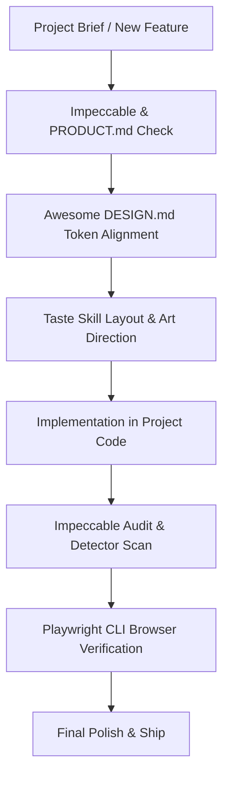

# Coordinated AI Design & Quality Workflow

This project integrates five advanced AI development and design tools in Google Antigravity to build, audit, test, and render production-grade interfaces.

---

## 1. Tool Catalog & Roles

| Tool | Type | Location | Primary Role |
|------|------|----------|--------------|
| **Taste Skill** (`design-taste-frontend`) | Agent Skill | `.agents/skills/design-taste-frontend` | Eliminates AI generic templates, enforces visual hierarchy, art direction, and layout originality. |
| **Awesome DESIGN.md** (`design-md`) | Design System Spec | `DESIGN.md` & `.agents/skills/design-md` | Durable plain-text design tokens, palette rules, and component anatomy for AI coding agents. |
| **Impeccable** | Agent Skill + Engine | `.agents/skills/impeccable` & `scripts/impeccable.cmd` | 24 design commands (`/impeccable audit`, `polish`, `critique`, `detect`) for UI audits, accessibility, and craft polish. |
| **Playwright CLI** | Global CLI + Skill | `@playwright/cli` & `.agents/skills/playwright-cli` | Token-efficient browser automation, page snapshots, visual inspection, and end-to-end user journey tests. |
| **img2threejs** | Agent Skill + 3D Pipeline | `.agents/skills/img2threejs` & `forge/` | Rebuilds reference images into procedural, code-only, animation-ready Three.js models. |

---

## 2. Integrated Step-by-Step Workflow



### Step 1: Context & Product Truth
- Before creating a surface, consult `PRODUCT.md` for business rules, constraints, and target audience.
- For new features, verify that operating constraints (e.g., zero online payment, WhatsApp concierge confirmation) are strictly honored.

### Step 2: Visual Authority & Token Compliance
- Open `DESIGN.md` to reference brand colors (Charcoal `#2A2A2A`, Silver `#C0C0C0`, Signal Red `#E10600`), typography scales, and component specs.
- Do not introduce arbitrary gradients, random fonts, or unlayered universal CSS resets.

### Step 3: Anti-Slop Art Direction (Taste Skill)
- Declare the design read: page kind, vibe language, and audience.
- Ensure buttons have generous luxury padding (`min-height: 48px`, `padding: 14px 32px`), responsive full-width mobile tap targets, and smooth interactive states.

### Step 4: Quality Gate & Audit (Impeccable)
- Run deterministic checks:
  ```powershell
  & ".agents/skills/impeccable/scripts/impeccable.cmd" detect src/app/page.tsx
  ```
- Or run against a running dev server:
  ```powershell
  & ".agents/skills/impeccable/scripts/impeccable.cmd" detect http://localhost:3000
  ```

### Step 5: Live Browser Journey Testing (Playwright CLI)
- Test navigation, viewports, and page interactions:
  ```powershell
  playwright-cli -s=audit open http://localhost:3000
  playwright-cli -s=audit snapshot
  playwright-cli -s=audit screenshot
  playwright-cli -s=audit close
  ```

### Step 6: 3D Procedural Assets (img2threejs)
- When a code-only 3D model is required:
  ```powershell
  python .agents/skills/img2threejs/forge/state.py init --profile generic
  ```

---

## 3. Maintenance & Updates

- **Taste Skill**: `npx skills update design-taste-frontend`
- **Awesome DESIGN.md**: Review updates at `references/awesome-design-md` and update `DESIGN.md`.
- **Impeccable**: `& ".agents/skills/impeccable/scripts/impeccable.cmd" update`
- **Playwright CLI**: `npm update -g @playwright/cli`
- **img2threejs**: Pull latest commits from `references/img2threejs` or run `npx --yes img2threejs@latest update`.
